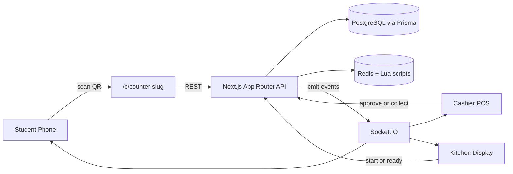
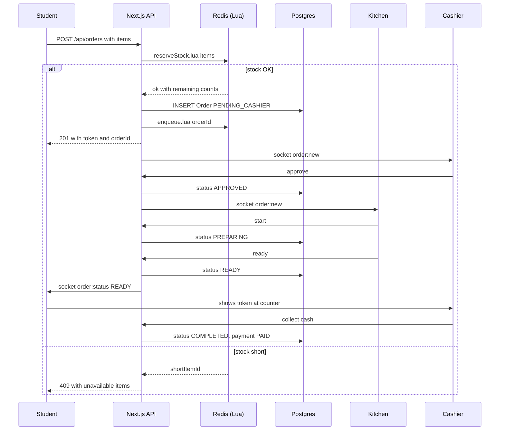
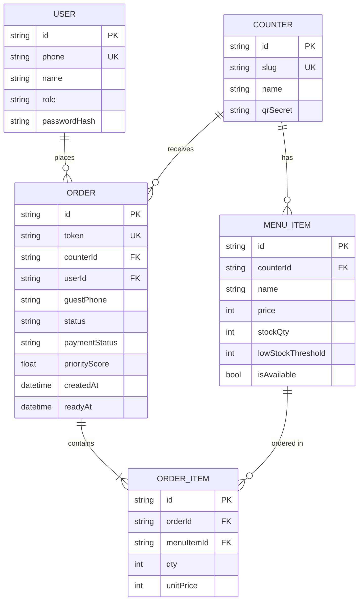

## Plan: Smart Queue Cafeteria MVP

One-repo Next.js (App Router) app with Postgres + Redis that lets students order from a phone (via per-counter QR), get a token, and wait in their seat while staff prep + cashier collect payment on pickup — with atomic stock reservation and a fair priority queue for rush hours.

**Steps**

1. **Scaffold project** (depends on none)
   - Init Next.js 14 App Router with TypeScript, Tailwind, ESLint.
   - Add deps: `prisma`, `@prisma/client`, `ioredis`, `socket.io`, `socket.io-client`, `next-auth`, `bcryptjs`, `qrcode`, `zod`, `node-cron`.
   - Replace default `next dev` with custom `server.ts` that wraps Next + attaches Socket.IO on the same port.
   - Create `.env.example` with `DATABASE_URL`, `REDIS_URL`, `NEXTAUTH_SECRET`, `QR_SIGNING_SECRET`, `PORT`.
2. **Database schema + Prisma migrations** (depends on 1)
   - In `prisma/schema.prisma`: `User`, `Counter`, `MenuItem`, `Order`, `OrderItem`, `OrderStatus` (enum: `PENDING_CASHIER`, `APPROVED`, `REJECTED`, `PREPARING`, `READY`, `COMPLETED`, `CANCELLED`), `PaymentStatus` (enum: `UNPAID`, `PAID`, `REFUNDED`).
   - `Counter` has `slug` (QR target), `qrSecret`, `name`.
   - `MenuItem` belongs to `Counter`, has `price`, `stockQty`, `lowStockThreshold`, `isAvailable` (manual off-switch).
   - `Order` has `token` (short, human-readable, e.g. `A-204`), `userId?` (nullable for guests), `guestPhone?`, `counterId`, `status`, `paymentStatus`, `priorityScore` (computed), timestamps per status transition.
3. **Redis layer + Lua scripts** (depends on 1)
   - `lib/redis.ts` — single ioredis client + a duplicate for blocking ops.
   - Key design:
     - `stock:{counterId}:{menuItemId}` → integer
     - `queue:{counterId}` → LIST of `orderId`, FIFO
     - `priority:{counterId}` → ZSET of `orderId → score` (higher = more urgent)
     - `lock:order:{orderId}` → short-TTL SETNX for state transitions
   - `lib/lua/reserveStock.lua` — atomically check stock for every line, decrement all-or-nothing, else return which item shorted. Returns `{1, remaining}` or `{0, shortItemId}`.
   - `lib/lua/releaseStock.lua` — refund stock on rejection/cancel (INCRBY).
   - `lib/lua/enqueue.lua` — push to LIST + ZSET with score = `createdAtMs + urgencyBoost`.
   - `lib/lua/promote.lua` — ZRANGEBYSCORE top-N, recompute score for fairness (anti-starvation: oldest waiting order's score is bumped every tick).
4. **REST API under `app/api/`** (depends on 2, 3; parallel with 5)
   - `POST /api/counters/[slug]/lookup` — guest entry from QR (no auth), returns menu + sets `guestSessionId` cookie.
   - `GET /api/menu?counterSlug=` — live menu with `stockQty` + `isAvailable` from Redis (cache fallback to DB).
   - `POST /api/orders` — items + counterSlug + optional `guestPhone`; runs `reserveStock.lua` → on success creates `Order` in a TX + calls `enqueue.lua`; on stock short returns 409 with offending items.
   - `POST /api/auth/login` (cashier/kitchen) — NextAuth credentials.
   - `POST /api/cashier/orders/[id]/approve|reject` — runs `releaseStock.lua` on reject, sets `OrderStatus`.
   - `POST /api/kitchen/orders/[id]/start|ready` — transitions + emits socket event to student.
   - `POST /api/cashier/orders/[id]/collect` — verifies token + marks `PaymentStatus=PAID` + `OrderStatus=COMPLETED` (this is where cash is collected).
   - `POST /api/orders/[id]/cancel` (student) — only allowed before `APPROVED`.
5. **Socket.IO server** (depends on 1; parallel with 4)
   - On `server.ts`: attach Socket.IO, JWT auth middleware (NextAuth session for staff, signed guest cookie for student).
   - Rooms: `student:{orderId}`, `cashier:{counterId}`, `kitchen:{counterId}`, `counter:{counterId}` (broadcasts).
   - Events: `order:new`, `order:status`, `stock:low`, `queue:promoted`.
6. **Student flow under `app/(student)/`** (depends on 4, 5)
   - `app/c/[slug]/page.tsx` — landing from QR; menu with stock badges ("3 left", greyed if 0); cart drawer; "Place order" CTA.
   - First-time order prompts phone number (no full signup needed, only for later lookup). Optional "Save my details" → creates account with OTP later.
   - Order status screen with live socket updates: `Pending → Approved → Preparing → Ready!`.
   - "Repeat last order" shortcut.
7. **Cashier flow under `app/(cashier)/`** (depends on 4, 5)
   - Login → counter selector (one cashier can serve multiple counters).
   - Pending-orders feed: token, items, payment badge (always `UNPAID` in MVP), `Approve` / `Reject` (with reason).
   - "Ready for pickup" tab: scan/type token → confirm cash received → `Collect & Complete`.
   - Stock dashboard: items at/below `lowStockThreshold`; quick `Mark unavailable` toggle (sets `isAvailable=false` + evicts pending orders that contain it).
8. **Kitchen flow under `app/(kitchen)/`** (depends on 4, 5)
   - Counter-scoped ticket board: ordered by `priorityScore` desc, then `createdAt`.
   - Each ticket: token, items, time-since-ordered (color-coded), `Start` → `Ready`.
   - Audio chime on new ticket.
9. **Fair-priority queue worker** (depends on 3, 5)
   - Tiny `node-cron` job in `server.ts` every 10s: for each active counter, scan `priority:{counterId}` ZSET, bump scores of orders waiting > 90s by +50 (anti-starvation). Surfaces old orders ahead of newer ones during rush.
   - Drives the "you've been waiting longest" badge in UI.
10. **QR generation + admin seed** (depends on 2)
    - `scripts/seed.ts` — demo counters (`canteen-a`, `canteen-b`), 8 menu items each with stock, one cashier, one kitchen user.
    - `scripts/qr.ts` — prints QR PNGs (one per counter) using `qrcode` lib for the URL `${BASE_URL}/c/{slug}`.
    - `app/admin/page.tsx` (role-gated) — view/reprint QRs, edit menu, see live counters.
11. **Polish for hackathon demo** (depends on 6, 7, 8)
    - PWA manifest + install hint so the QR link feels app-like.
    - Loading skeletons + offline cart persistence in `localStorage`.
    - One-screen demo script on landing: "1. Scan QR → 2. Order in 20s → 3. Get notified → 4. Pay cash at counter".
    - `README.md` with architecture diagram + how-to-run.

**Diagrams**

**Relevant files**
- `prisma/schema.prisma` — full data model (the ER diagram above).
- `lib/redis.ts` — ioredis clients.
- `lib/lua/reserveStock.lua`, `releaseStock.lua`, `enqueue.lua`, `promote.lua` — atomic ops, loaded via `SCRIPT LOAD` on boot.
- `lib/queue.ts` — wrappers around Lua calls; exposes `reserveAndEnqueue`, `releaseStock`, `promoteOldOrders`.
- `server.ts` — custom Next + Socket.IO + cron bootstrap.
- `app/api/orders/route.ts` — order creation hot path (`reserveAndEnqueue`).
- `app/api/cashier/orders/[id]/route.ts`, `app/api/kitchen/orders/[id]/route.ts` — staff transitions.
- `app/(student)/c/[slug]/page.tsx`, `app/(student)/orders/[id]/page.tsx` — student PWA.
- `app/(cashier)/dashboard/page.tsx`, `app/(kitchen)/board/page.tsx` — staff screens.
- `scripts/seed.ts`, `scripts/qr.ts`, `scripts/smoke.ts`, `scripts/concurrency-test.ts` — demo + verification.
- `lib/socket-events.ts` — shared event-type constants for client + server.
- `hooks/useOrderSocket.ts` — client subscription helper.

**Verification**
1. `npm run dev` boots Next + Socket.IO on one port; `redis-cli ping` returns `PONG`; `prisma migrate dev` runs clean.
2. `npm run seed` populates 2 counters, 16 items, 3 users (student, cashier, kitchen).
3. End-to-end happy path in `scripts/smoke.ts`: place order as guest → approve as cashier → ready as kitchen → collect as cashier → assert DB `status=COMPLETED`, `paymentStatus=PAID`.
4. Concurrency test `scripts/concurrency-test.ts`: 50 parallel POSTs for the same item with `stockQty=10` → exactly 10 succeed with 201, 40 fail with 409 (proves no oversell).
5. Manual: print two QRs, scan one on phone, place order; verify kitchen board updates within 1s and student phone flips to READY within 1s of staff action.
