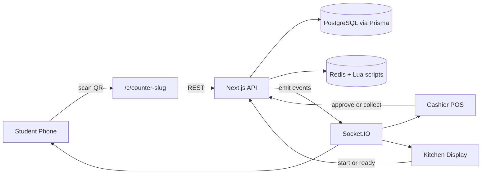

# Smart Queue Cafeteria MVP

> Hackathon MVP — students scan a counter QR, order from their seat, and pay cash at pickup. Atomic stock reservation and a fair priority queue keep the rush fair.

**Judge runbook:** 👉 [Judge quickstart](#judge-quickstart) below. **One command** gets you to a running demo in about three minutes.

---

## What judges will see

1. A student phone opens `/c/canteen-a` (scanned from a QR code) and orders food.
2. The cashier dashboard at `/cashier` shows the order coming in via Socket.IO in real time.
3. The kitchen dashboard at `/kitchen` shows the same order. The kitchen marks it *cooking* → *ready*.
4. The cashier marks it *paid* after collecting cash. The student sees the status flip on their phone without refresh.
5. Stock is reserved atomically in Redis — try 50 parallel orders against 10 stock and exactly 10 succeed (`npm run concurrency`).

---

## Judge quickstart

### Prerequisites

- **Node.js 20+** — `node -v` should print `v20.x` or higher.
- **Administrative shell** on Windows (PowerShell **Run as administrator**) so the installer can start services. On Linux/macOS you'll need `sudo` once.

The installer pulls down **PostgreSQL 16** and **Redis** itself if either is missing — you do not need to install them by hand.

### Windows (PowerShell, elevated)

```powershell
Set-ExecutionPolicy -Scope Process -ExecutionPolicy Bypass
.\install.ps1
npm run dev
```

### Linux / macOS

```bash
bash install.sh
npm run dev
```

The server logs `[smart-queue] ready on http://0.0.0.0:3001` when it boots.

### Open the demo

The default port is **3001** (3000 is often taken on developer machines). Visit:

| URL | What it shows |
|-----|---------------|
| http://localhost:3001/c/canteen-a | Student QR landing — order from a seat |
| http://localhost:3001/c/canteen-b | Second counter's menu |
| http://localhost:3001/login     | Staff login (Cashier / Kitchen / Admin) |
| http://localhost:3001/cashier   | Cashier POS — needs login |
| http://localhost:3001/kitchen   | Kitchen ticket board — needs login |

### Demo accounts (created by `npm run seed`)

| Role | Phone | Password |
|------|-------|----------|
| Cashier | `01700000001` | `cashier123` |
| Kitchen | `01700000002` | `kitchen123` |
| Admin   | `01700000099` | `admin123` |

### 60-second smoke test

1. Open http://localhost:3001/c/canteen-a in one window.
2. Open http://localhost:3001/login in another — log in as **Cashier**.
3. Place an order from the student window. You'll see it appear in the cashier POS in real time.
4. Approve the order on the cashier screen. Open the kitchen URL in a third window (log in as **Kitchen**) — the order moves to the kitchen board.
5. Click **Start** then **Ready** in the kitchen; the student window flips to *Ready for pickup* without a refresh.

If anything goes sideways, see [TROUBLESHOOTING.md](./TROUBLESHOOTING.md).

---

## Architecture



**Stack:** Next.js 14 (App Router, custom `server.ts`) · PostgreSQL via Prisma · Redis with custom Lua scripts for atomic stock + queue ops · Socket.IO for real-time updates · PWA manifest + service worker so the QR link feels app-like.

---

## Key design decisions

- **All-or-nothing reservation.** `lib/lua/reserveStock.lua` checks every line first, then decrements. A cart with even one out-of-stock item fails atomically and stock is never partially decremented.
- **Anti-starvation priority queue.** A cron job in `lib/promoter.ts` runs every 10 seconds and bumps the priority score of orders that have been waiting > 90 s, so a fresh burst of orders can't indefinitely starve a slow order.
- **Guest-first ordering.** No signup needed. Phone is captured at checkout (optional) and used only for staff lookup.
- **Cash at pickup.** MVP skips payment-gateway integration; cashier confirms a token to mark the order `PAID`.
- **Single-process Socket.IO + Next.** `server.ts` mounts Socket.IO at `/api/socketio` on the same port as the Next request handler, so a judge runs exactly one command (`npm run dev`).

---

## File map

| Path | Purpose |
|------|---------|
| `server.ts` | Next + Socket.IO + cron promoter (single process) |
| `prisma/schema.prisma` | Data model (User, Counter, MenuItem, Order, OrderItem) |
| `lib/lua/*.lua` | `reserveStock` / `releaseStock` / `enqueue` / `promote` |
| `lib/queue.ts` | Typed wrappers around Lua scripts |
| `lib/bus.ts` | Socket emit helpers |
| `lib/promoter.ts` | Cron job that promotes starving orders |
| `app/api/orders/route.ts` | Hot path: reserve + persist + enqueue + emit |
| `app/c/[slug]/page.tsx` | QR landing menu |
| `app/cashier/page.tsx` | Cashier POS |
| `app/kitchen/page.tsx` | Kitchen ticket board |
| `scripts/seed.ts` | Demo data (2 counters, 16 items, 3 staff) |
| `scripts/qr.ts` | Printable QR sheets |
| `scripts/concurrency-test.ts` | Atomicity proof |
| `install.ps1` / `install.sh` | One-shot bootstrap (Node + Postgres + Redis + migrate + seed) |
| `TROUBLESHOOTING.md` | Common setup errors |

---

## Verify atomicity

```bash
npm run concurrency
```

Fires 50 parallel orders against items with 10 stock → exactly 10 should succeed. This is the proof that the Lua-based reservation holds under contention.

---

## License

MIT for the hackathon.